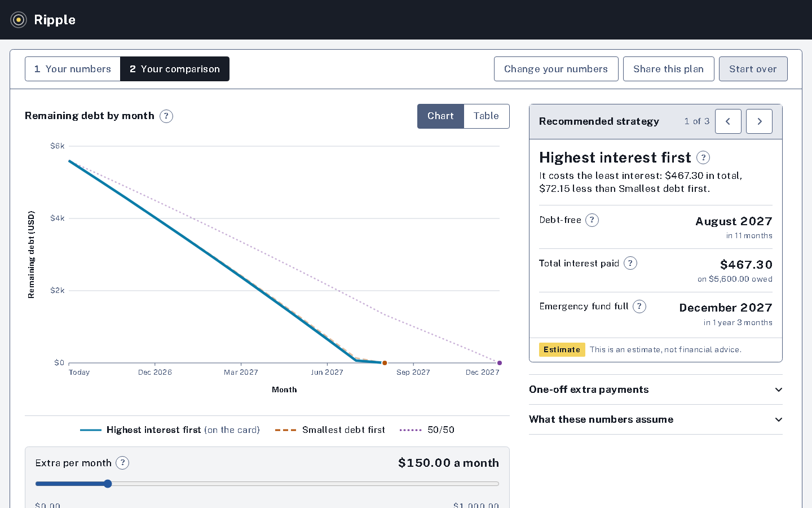
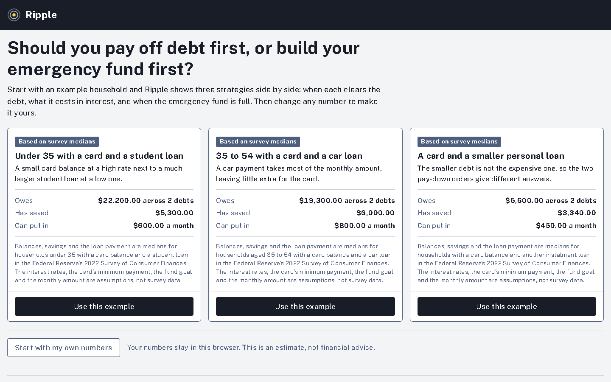
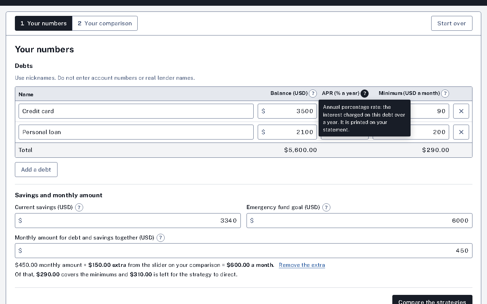
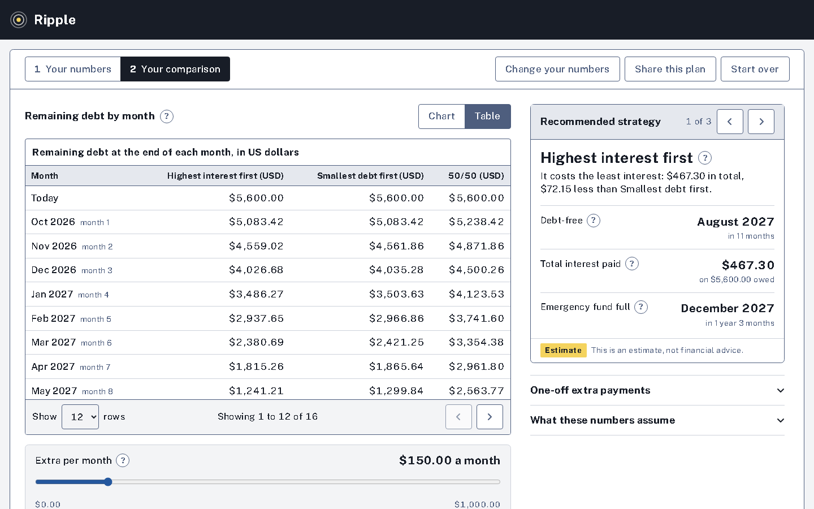
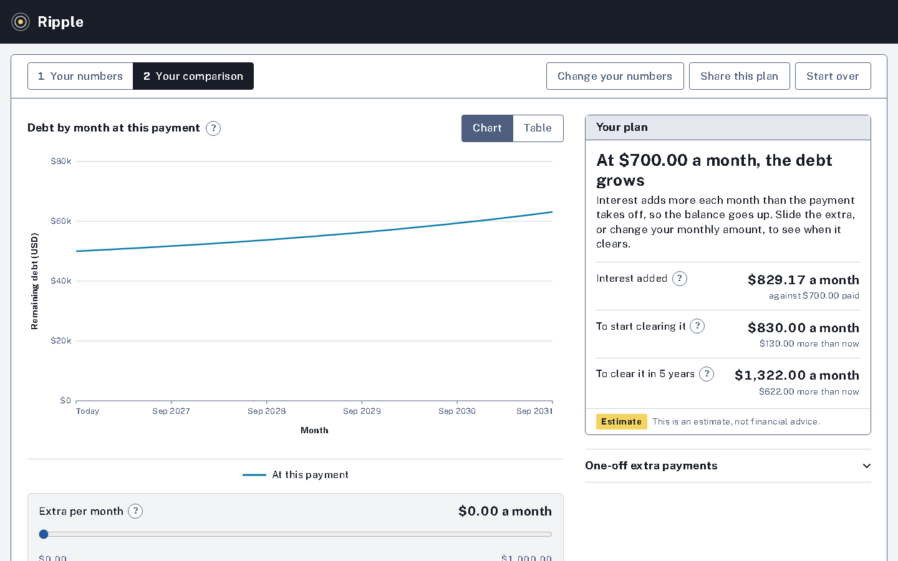

# Ripple

**Should you pay off debt first, or build your emergency fund first?**

Ripple is a debt-versus-savings planner. You enter what you owe, what you have saved and what
you can put in each month, and it shows how three ways of paying compare: when each one clears
the debt, how much interest it costs, and when the emergency fund is full.

It is an estimate, not financial advice.



## Purpose

Advice on paying down debt is usually a rule of thumb: pay the highest rate first, or the
smallest balance first, or save before you do either. Which one is right depends on your own
numbers, and the difference is hard to see without working it out month by month.

Ripple does that working out and shows the result plainly:

- **Three strategies, one recommendation.** Highest interest first, smallest debt first, and
  50/50 (half the spare money to savings until the fund is full). One is recommended, with the
  reason in a sentence.
- **What extra money buys.** A slider adds an amount each month and the chart redraws as you
  move it: "With $150.00 extra a month, you are debt-free 3 months sooner and pay $204.95 less
  interest than without it."
- **Honest about the awkward cases.** With one debt and a full fund the three strategies are
  the same plan, and Ripple says so and says what to add. If a payment is too small to ever
  clear the debt, it shows where the balance goes and what payment would turn it round,
  instead of an error.
- **No account, nothing stored.** Your numbers stay in your browser. Nothing is saved on the
  server unless you create a share link.

It opens on example households built from the Federal Reserve's Survey of Consumer Finances,
so there is something to look at before you type anything.

## Screens

| | |
| --- | --- |
|  Start from an example, or your own numbers |  Step 1: your numbers, with definitions behind each "?" |
|  The same result as a paged table |  A payment too small to clear the debt is shown, not refused |


## Built with

- **Web:** Next.js, TypeScript, Tailwind CSS (`web/`)
- **API:** ASP.NET Core minimal APIs on .NET 10, EF Core (`api/`)
- **Database:** PostgreSQL

## Set up

You need [Docker](https://www.docker.com/), the [.NET 10 SDK](https://dotnet.microsoft.com/download)
and [Node.js 24](https://nodejs.org/).

1. **Start the database.** PostgreSQL runs in a container on port 5435.

   ```
   docker compose up -d
   ```

2. **Start the API** on http://localhost:5195. It creates its tables and the example households
   the first time it runs.

   ```
   cd api
   dotnet run --project src/Ripple.Api --launch-profile http
   ```

3. **Start the web app** in a second terminal.

   ```
   cd web
   npm install
   npm run dev
   ```

4. Open http://localhost:3300.

The web app passes `/api/*` through to the API (`API_ORIGIN`, default
`http://localhost:5195`), so the browser only ever talks to one address.

## Tests

| Command | Where | What it covers |
| --- | --- | --- |
| `dotnet test` | `api/` | The engine as unit tests (a hand-worked schedule to the cent, each strategy's ordering, every guard rail, invariants over generated scenarios, the recommendation, payments that do not clear the debt), plus the API end to end against a real Postgres in a container |
| `npm test` | `web/` | Formatting, the form-to-request conversion, chart helpers, and the contrast of every colour pair |
| `npm run test:e2e` | `web/` | The main paths in a real browser at 1360px and 390px, with accessibility checks. Needs the database, API and web app running. |
| `node scripts/readme-shots.mjs` | `web/` | Retakes the screenshots in this README |

## How it works

| Folder | What is in it |
| --- | --- |
| `api/src/Ripple.Domain` | The engine, with no database and no HTTP: `Simulator`, `Planner` |
| `api/src/Ripple.Data` | The EF Core context and migrations |
| `api/src/Ripple.Api` | Endpoints, validation, rate limits, sharing, the examples |
| `web/app` | Two screens: the planner (`/`) and a shared plan (`/s/<code>`) |
| `web/components` | The form, the comparison, the chart, tooltips, sharing |
| `web/lib` | The API client, the draft kept in the browser, formatting, colours |
| `scripts/scf-examples.mjs` | Works out the example households from the survey file |

### The engine

Everything is `decimal`. Each month, in this order:

1. Interest is added to every open debt: balance × APR ÷ 12, rounded to the cent with halves
   rounded away from zero (0.505 becomes 0.51).
2. Every open debt gets its minimum payment, or its whole balance if that is smaller.
3. What is left of the monthly amount is the "extra". A cleared debt's minimum is part of the
   extra from the next month on.
4. 50/50 only: while savings are below the goal, half the extra (rounded down to the cent)
   goes to savings.
5. The rest, plus any one-off payment for that month, goes to the strategy's target debt, and
   on to the next target if that one clears.
6. With no debt left, what remains goes to savings up to the goal, so every strategy reports
   the month the fund is full.

Targets: highest APR for Highest interest first and for 50/50; smallest balance for Smallest
debt first. Ties are broken the same way every time (see `Simulator.cs`).

The engine's answers were checked against a second, independent implementation of the same
rules and matched to the cent.

**When the payment does not clear the debt.** If interest is added as fast as it is paid, or
the plan would take more than 50 years, there is no payoff date to report. The engine returns
the next five years of balances at that payment, the interest added in the first month, the
smallest whole-dollar payment that clears the debt at all, and the smallest that clears it in
five years (`Simulator.Stall`).

Two inputs are still refused, with a message beside the field: a monthly amount below the
minimum payments, and an emergency fund goal that cannot be reached in 50 years.

### How Recommended is chosen

1. The cheapest strategy wins: lowest total interest, then earliest debt-free month, then
   earliest fund month.
2. One exception. If savings are below the goal **and** under one month of the monthly amount,
   and 50/50 fills the fund sooner while clearing the debt at most 3 months later, 50/50 is
   recommended instead. With almost nothing saved, one surprise bill goes back on a card.

The rule, its two constants and the sentence shown on the card all live in `Planner.cs`, with
tests.

### Limits

60 requests a minute per visitor, 20 a minute on simulations, 10 share links an hour, 32 KB
per request, 20 debts per scenario. 

## The example households

The three examples are built from the Federal Reserve's 2022 Survey of Consumer Finances,
summary extract public data. To reproduce them:

1. Download the CSV version from https://www.federalreserve.gov/econres/scfindex.htm
   (direct: https://www.federalreserve.gov/econres/files/scfp2022excel.zip) and unzip it.
2. Run `node scripts/scf-examples.mjs path/to/SCFP2022.csv`.
3. The printed medians are the balances, savings and loan payments in
   `api/src/Ripple.Api/Examples.cs`.

What is and is not survey data:

- **From the survey:** each debt's balance, the household's liquid savings, and the monthly
  payment on the student, car or personal loan. They are weighted medians for the group, each
  taken on its own, so an example is a typical household and not one family's record. Amounts
  are in 2022 dollars.
- **Assumptions:** every interest rate, the credit card's minimum payment, the emergency fund
  goal and the monthly amount. The survey extract has none of these. The app says so on every
  example.

## Deploy

- **API and database on Railway:** a PostgreSQL service, and a service that builds
  `api/Dockerfile` with `ConnectionStrings__Default` set to the database's connection string.
- **Web on Vercel:** root directory `web/`, with `API_ORIGIN` set to the Railway API's address.

The Docker image has not been built and run yet, so treat the Dockerfile as untested.
